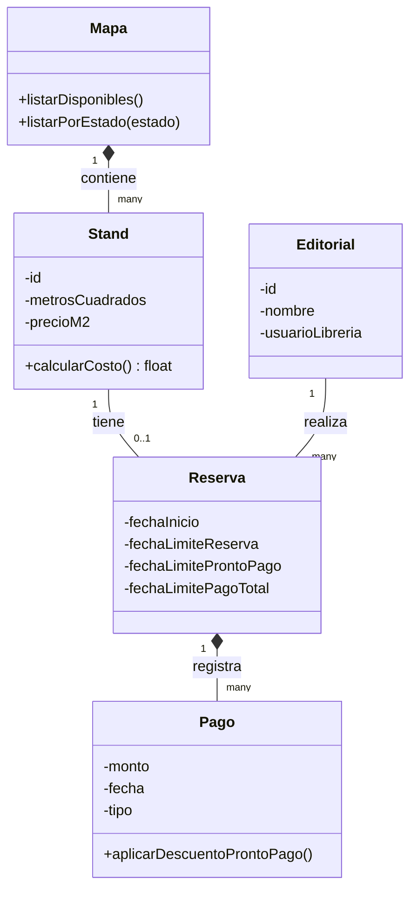
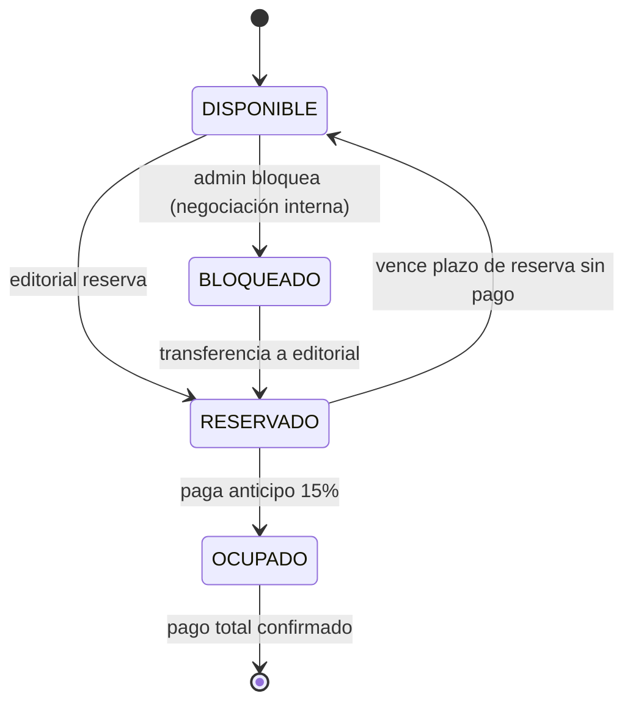

Stand
atributos stand:
id
metros cuadrados (se establece un precio por metro cuadrado y se hace una multiplicacion de ese precio por la dimension del stand)

Ahora Stand pertenece a mapa ya que en el mapa tenemos diversos puestos de stand con su dimesion correspondiente, es decir que sin mapa de salon no existiría stand

Los Stand tienen 4 estados: DISPONIBLE, RESERVADO, OCUPADO, BLOQUEADO (ver diagrama de estados abajo).

---

## Diagrama de clases

## Diagrama de estados (Stand)

